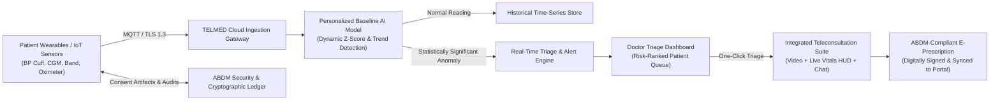

# TELMED — Continuous Remote Patient Monitoring & Telemedicine Platform

> **An affordable, secure, and scalable cloud-based platform connecting chronic patient telemetry and doctor teleconsultation into a unified clinical system.**

[](LICENSE)
[](https://vitejs.dev/)
[](https://react.dev/)
[](https://www.typescriptlang.org/)
[](https://tailwindcss.com/)
[](https://abdm.gov.in/)

---

## 📌 Problem Statement

Many patients across India—especially those with chronic conditions like **diabetes, hypertension, heart disease, and COPD**—live far from tertiary hospitals or cannot visit them regularly due to geographical and financial constraints. 

Between periodic checkups, doctors have zero visibility into the patient’s condition. Consequently, subtle but dangerous warning signs—such as a **gradual 48-hour rising blood pressure trend, nocturnal desaturations, or acute postprandial glucose spikes**—go completely unnoticed until an emergency strikes.

Existing telemedicine apps mostly provide isolated video calls and do not continuously monitor patient vitals. Conversely, remote monitoring devices send telemetry to separate, closed proprietary silos, leaving doctors with scattered data, delayed alerts, alarm fatigue, and weak privacy safeguards. 

**TELMED bridges this gap by unifying continuous IoT telemetry, personalized baseline anomaly detection, and in-platform teleconsultations with e-prescriptions into one cohesive platform.**

---

## 💡 Solution Architecture



---

## 🎨 Design System & Color Palette

The interface is custom-tailored with the following curated palette:

| Color Code | Name / Role | Usage in TELMED |
| :--- | :--- | :--- |
| **`#6E1A37`** | **Deep Wine / Burgundy** | Primary brand identity, navigation bar, clinical headers, primary action buttons |
| **`#AE2448`** | **Crimson / Berry Red** | Emergency alerts, critical risk badges, vital spikes, Emergency SOS |
| **`#72BAA9`** | **Teal / Sage Green** | Stable/safe vitals indicators, connected IoT streams, telemetry trendlines |
| **`#D5E7B5`** | **Soft Mint / Lime** | Baseline tolerance bands (±2σ safe zone), success pills, compliance badges |
| **`#ECECEC`** | **Off-White / Light Slate** | Neutral background, subtle card borders, secondary containers |

---

## ✨ Key Features

### 1. Multi-Sensor Data Collection & Live Telemetry Stream
- **Continuous Monitoring:** Real-time ingestion of Heart Rate (bpm), Oxygen Saturation ($SpO_2$ %), Blood Pressure (Systolic & Diastolic mmHg), Continuous Glucose ($mg/dL$), and Body Temperature ($^\circ C$).
- **Simulated Testbed:** Built-in interactive simulator allowing doctors and evaluators to trigger real-world clinical scenarios:
  - *Hypertensive Urgency / Crisis* (Systolic surge to $175+$ mmHg)
  - *Postprandial Hyperglycemic Spike* (Glucose surge to $280+$ mg/dL)
  - *Silent Hypoxemia / Respiratory Distress* ($SpO_2$ dropping below $90\%$)
  - *Acute Hypoglycemic Crash* (Glucose dropping to $54$ mg/dL)
  - *Cardiac Tachycardia / Arrhythmia* ($HR > 130$ bpm)
  - *Safe Baseline Recovery*
- **Low-Bandwidth Mode:** Tailored for 2G/3G rural networks in India with compact telemetry packets.

### 2. Smart Alerts via Personalized Baseline Engine
- **Eliminates False Alarm Fatigue:** Fixed generic thresholds (e.g., 140 mmHg for everyone) cause alarm fatigue and miss subtle deterioration. TELMED learns each individual patient’s mean and standard deviation:
  $$\text{Z-Score} = \frac{x_t - \mu_{\text{baseline}}}{\sigma_{\text{baseline}}}$$
- **Trend Detection:** Detects progressive 48-hour rising trends before acute hypertensive or diabetic emergencies occur.
- **Composite Early Warning Score (NEWS2 adapted):** Ranks patients by multi-vital clinical severity and underlying chronic comorbidity weighting.

### 3. Doctor Triage Dashboard
- **Risk-Prioritized Patient Queue:** Orders patients dynamically by computed risk score (Critical, High, Moderate, Stable).
- **Interactive Multi-Metric Trend Charts:** Recharts visualization featuring personalized baseline tolerance zones (shaded soft mint `#D5E7B5`), population reference thresholds, and clinical alert annotations.
- **Alert Acknowledgement:** Doctors can review anomaly explanations, sigma deviations, and triage actions.

### 4. Integrated Teleconsultation Suite
- **Side-by-Side In-Consultation Experience:** One-click launch from any alert or patient card.
- **Floating Live Vitals HUD:** Live telemetry streams directly over the video consultation screen so the physician sees real-time patient response.
- **Consultation Chat with Vitals Stamping:** Doctors can capture and timestamp the patient's current vitals snapshot directly into the session transcript.
- **Camera & Mic Controls:** Seamless video calling with optional toggle for physical local webcam or high-definition telehealth simulation.

### 5. Official ABDM E-Prescription Pad
- **Indian NMC & ABDM Standards:** Formulates full prescriptions with diagnosis, medication table (dosage, frequency such as `1-0-1 after food`, duration), dietary advice, and lifestyle modifications.
- **One-Click PDF / Print:** Generates official e-prescriptions with digital verification hashes and doctor registration details.

### 6. Patient & Rural Caregiver Portal
- **Health Traffic Light Status:** Easy-to-understand status cards for patients and rural health workers (ASHA / ANM).
- **One-Tap Emergency SOS (108):** Instant ambulance and triage notification with live location and vitals dispatch.
- **Manual Vitals Logger:** Allows logging readings taken on standalone home devices.

### 7. Security, ABDM Consent & Cryptographic Audit Ledger
- **Patient Consent Artifacts:** Granular toggles for telemetry streaming, diagnostic reports, and emergency access.
- **Data Protection:** Simulated AES-256-GCM encryption at rest and TLS 1.3 in transit.
- **Immutable Audit Trail:** SHA-256 hashed ledger tracking every clinical record access, IoT packet, and consent update.

---

## 🚀 Getting Started

### Prerequisites
- **Node.js** (v18 or higher)
- **npm** (v9 or higher)

### Installation & Run

1. Clone the repository:
   ```bash
   git clone https://github.com/AbhyasKathuria/TELMED.git
   cd TELMED
   ```

2. Install dependencies:
   ```bash
   npm install
   ```

3. Start the local development server:
   ```bash
   npm run dev
   ```
   Open your browser at `http://localhost:5173`.

4. Build for production:
   ```bash
   npm run build
   ```

---

## 🛠 Tech Stack

- **Framework:** React 18, Vite
- **Language:** TypeScript 5
- **Styling:** Tailwind CSS 3.4
- **Icons:** Lucide React
- **Data Visualization:** Recharts
- **Architecture:** Client-side real-time state machine with simulated IoT MQTT streaming and ABDM consent models

---

## 📄 License

This project is licensed under the MIT License — see the [LICENSE](LICENSE) file for details.
